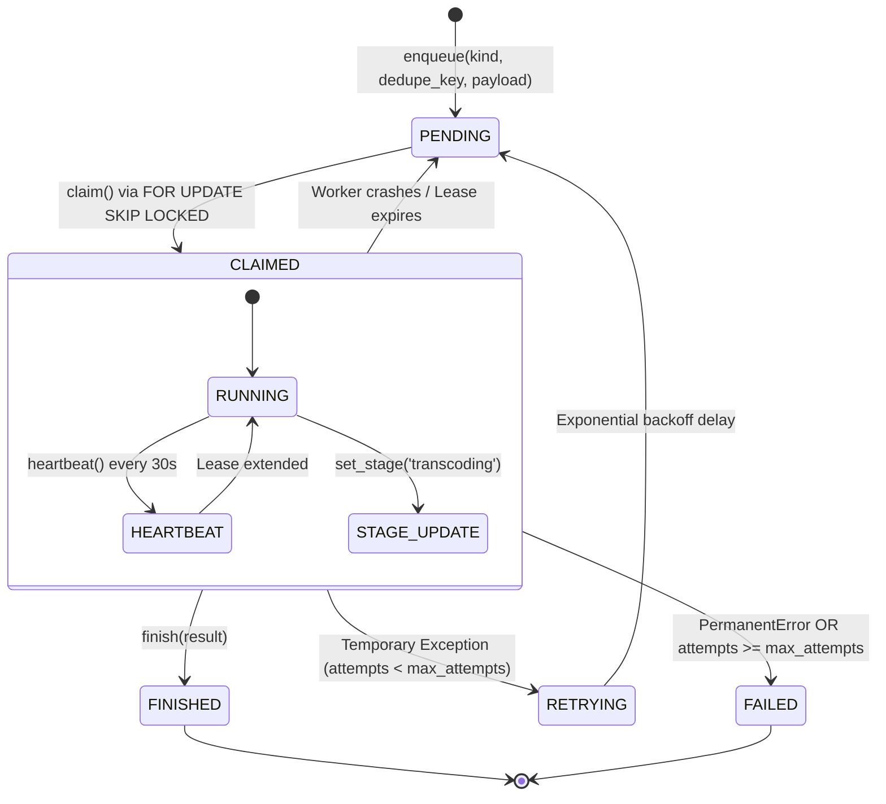

<div align="center">

# 🐘 pg-lease-queue
### Durable, Distributed Job Queue for PostgreSQL & Supabase (Zero Redis, Zero Celery)

[](https://postgresql.org)
[](https://github.com/Kaio-Comk/pg-lease-queue)
[](https://github.com/Kaio-Comk/pg-lease-queue)
[](https://github.com/Kaio-Comk/pg-lease-queue)
[](https://opensource.org/licenses/MIT)

**Durable, concurrent background jobs directly in your existing PostgreSQL database.**  
*Atomic row leases, lock-free parallel consumers, automatic crash recovery, idempotency deduplication, and exponential backoff.*

[Why Not Redis?](#-why-pg-lease-queue) • [Lifecycle & State Machine](#-state-machine--guarantees) • [Installation](#-installation) • [Quickstart](#-quickstart) • [SQL Migration](#-sql-architecture)

</div>

---

## ⚡ Why pg-lease-queue? (Postgres as a Queue Done Right)

In modern architectures, adding Redis, RabbitMQ, or Celery introduces extra infrastructure, dual-write consistency issues, and operational headache.

| Feature | Redis / BullMQ | Celery + RabbitMQ | `pg-lease-queue` |
|---|:---:|:---:|:---:|
| **Infrastructure Overhead** | ⚠️ Extra server/service | ❌ Two extra servers | ✅ **Zero (Uses your existing Postgres/Supabase)** |
| **ACID Consistency** | ❌ Dual-write desync | ❌ Separate state | ✅ **100% Atomic with business transactions** |
| **Worker Crash Recovery** | ⚠️ Needs ACK timeout | ⚠️ Complex visibility timeout | ✅ **Deterministic Leases & Heartbeats** |
| **Duplicate Prevention** | Custom Lua scripts | Manual locking | ✅ **Partial Unique Index on `(kind, dedupe_key)`** |
| **Row Level Security (RLS)**| ❌ None | ❌ None | ✅ **Fully locked to Service Role** |

---

## 🏗️ State Machine & Guarantees



### Core Guarantees
1. **No Double Processing (`FOR UPDATE SKIP LOCKED`):** Multiple workers claim jobs in parallel without lock contention or deadlocks.
2. **Deduplication:** Enqueueing the exact same task twice returns the existing active job instead of duplicating work.
3. **Crash Recovery:** If a worker crashes, loses power, or runs out of memory, its job lease expires and is automatically recovered by another worker.
4. **Heartbeat Protection:** Long-running tasks (transcoding, AI inference, scraping) renew their lease dynamically. If a worker loses its lease, its stale result is discarded safely.

---

## 📦 Installation

```bash
# 1. Apply the migration to your database (Supabase SQL Editor or psql)
psql -d mydb -f sql/001_job_queue.sql

# 2. Install the client library
pip install git+https://github.com/Kaio-Comk/pg-lease-queue.git
```

---

## 🚀 Quickstart

Works out-of-the-box with `supabase-py` or standard PostgreSQL connection pools:

```python
import asyncio
from supabase import create_client
from pgleasequeue import LeaseQueue, PermanentError, run_worker

# 1. Initialize queue with Service Role key
supabase = create_client("https://xyz.supabase.co", "SERVICE_ROLE_KEY")
queue = LeaseQueue(supabase)

# 2. Producer: Enqueue idempotent job
queue.enqueue(
    kind="transcode",
    dedupe_key="video:892",
    payload={"video_id": 892, "target_format": "aac"},
    priority=100
)

# 3. Worker implementation
async def process_job(job):
    print(f"Processing job {job.id}: {job.payload}")
    
    # Non-retryable error
    if not job.payload.get("video_id"):
        raise PermanentError("Invalid payload: missing video_id")
        
    # Long running work (heartbeat runs automatically in background)
    queue.set_stage(job.id, worker_id="worker-1", stage="encoding")
    await asyncio.sleep(5)
    
    return {"status": "success", "file_url": "https://storage.com/892.mp4"}

# 4. Start concurrent worker loop
async def main():
    await run_worker(queue, process_job, worker_id="worker-1", kind="transcode")

asyncio.run(main())
```

---

## 🧪 Testing

```bash
pip install -e ".[dev]"
pytest -v
```

---

## 📄 License

Distributed under the **MIT License**. See `LICENSE` for details.

<div align="center">
  <sub>Built with ❤️ by Kaio Lima. If pg-lease-queue simplified your background jobs, please star ⭐ the project!</sub>
</div>
